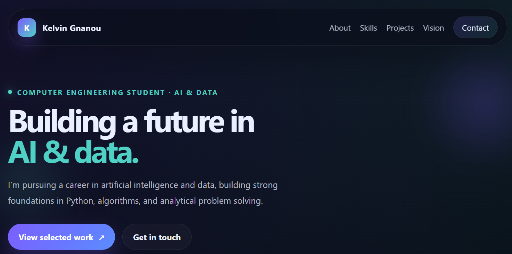

# Kelvin Gnanou — Portfolio

<div align="center">


### Computer Engineering Student

Building a foundation in Python, data analysis, and machine learning.

<br>

[](https://kelvin-gnanou.github.io)
[](https://github.com/kelvin-gnanou)
[](https://www.linkedin.com/in/kelvin-gnanou-a1755b40b/)

</div>

---

## Preview

<p align="center">
  
</p>

## About

I’m a computer engineering student working toward a career in artificial intelligence and data. I’m developing foundations in Python, algorithms, data structures, SQL, and analytical problem solving.

## Focus Areas

- Data analysis and data workflows
- Statistics and analytical thinking
- Machine learning fundamentals
- Artificial intelligence applications

## Technical Foundations

| Area | Tools and topics |
| --- | --- |
| Languages | Python · SQL · C · C++ · JavaScript |
| Data and computing | Data structures · Algorithms · Complexity analysis |
| Tools | Linux · Git · GCC · Clang · GDB |
| Web | HTML · CSS |

## Projects and Practice

### Data Structures in C

Implementations of linked lists, stacks, queues, and trees, with practice in memory management and organizing data.

[View repository](https://github.com/dann-H7/data-struct)

Additional practice includes Python automation, C/C++ development tooling, and responsive web interfaces.

## Run Locally

```bash
git clone https://github.com/kelvin-gnanou/kelvin-gnanou.github.io.git
cd kelvin-gnanou.github.io
python3 -m http.server 8000
```

Open `http://localhost:8000` in a browser. Use a local server so the JavaScript modules load correctly.

## Project Structure

```text
.
├── index.html
├── assets/
│   ├── icons/favicon.svg
│   └── images/
│       ├── preview.png
│       └── profile.jpeg
├── css/
│   ├── base/
│   ├── components/
│   ├── layout.css
│   ├── main.css
│   ├── responsive.css
│   └── utilities.css
├── js/
│   ├── main.js
│   └── modules/nav.js
├── .gitignore
├── LICENSE
└── README.md
```

## Deployment

The portfolio is a static site published with GitHub Pages. Configure Pages to publish the repository root from the deployment branch.

## Contact

- Email: [kelvin.gnanou.dev@gmail.com](mailto:kelvin.gnanou.dev@gmail.com)
- [LinkedIn](https://www.linkedin.com/in/kelvin-gnanou-a1755b40b/)

## License

See [LICENSE](./LICENSE).

He source code is licensed under the MIT License.

Personal content, images, and branding are not covered by this license.
